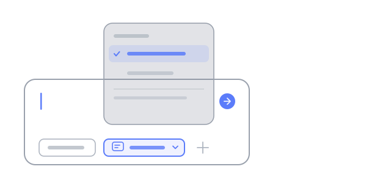

# Prompt presets

English | [中文](README.zh.md)

Adds a system-prompt preset chip to the right of the composer's permission control, plus a **Prompt presets** page in Settings. Picking a preset affects the current session only; from the next model request on, a custom preset's text replaces DSH's assembled prompt (optionally prefixed by a short DSH preamble), rather than extending it.



## Install

Requirements: **DeepSeek Harness 0.2.2-rc.5** or newer, with the `systemPrompt`, `sessionProjections`, `settings`, and `commands` Host services and the `conversation.input.left` / `settings.section` client slots. Built and tested on the Desktop (`desktop`) profile.

1. Clone the repository somewhere permanent and install its Host dependency:

   ```sh
   git clone https://github.com/WMZZwmzz/dsh-prompt-presets.git
   cd dsh-prompt-presets
   pnpm install --prod
   ```

2. Add the folder to your DSH profile as a bundle. The Plugin Manager's **Install bundle** accepts a local folder; to link it manually, the profile needs:

   - a dependency entry in the profile `package.json`:
     `"@local/prompt-presets": "link:<absolute path to this folder>"`;
   - `"@local/prompt-presets"` in `dsh.profile.bundles` of the same file.

3. Restart DSH once. The Host half (the `Config` schema and the `system-prompt/assemble` listener) loads at boot; refreshing the page only updates the browser half.

4. Open **Settings → Prompt presets**, add a preset, save, then switch the current session from the chip in the composer.

> The plugin was written against the DSH 0.2.2-rc.5 APIs and may need updates if a future DSH release changes the prompt-assembly or settings APIs.

## Behavior

- **Placement** — a `conversation.input.left` slot entry; the trigger carries `order: 2`, so under the installed `claude-style` skin it sits between the permission group (`order: 1`) and the commands plus button (`order: 3`). Without that skin the row has no explicit orders and the chip stays right of the permission/plan controls.
- **State** — one Host session projection, `promptPreset`, folded from this plugin's own `/prompt-preset <id>` command records (`command/run` + `command/done`). The choice lives in the session log, so reopening or resuming a session restores it; other sessions keep their own choice.
- **Preset source** — the live settings form of the `prompt-presets` Host row. The chip and the Settings page read the same values, so a saved edit reaches the composer immediately.
- **System prompt** — a prepended `system-prompt/assemble` listener. When the session's selected preset is a custom one, it returns that preset's text as the sole prompt section (`plugin:prompt-preset`, `interpolate: false`), so the model receives exactly the configured text. With `keepDshBasics` on (the default), the short `DSH_BASICS_TEXT` preamble — identity, tool guidance, and an environment pointer — is prepended first; turn it off for an exact replacement. The built-in `default` preset leaves the assembly untouched, which means DSH's own prompt. Subagent sessions (session header `origin: 'subagent'`) are left untouched as well.
- **Subagents** — a subagent session records no choice and is skipped, so it keeps DSH's own system prompt.
- **Cache** — switching rewrites the system prompt, so cached request prefixes may be invalidated.
- **Receipt** — each switch runs a real session command, so the transcript shows one command receipt (`prompt-preset` with the preset label as its summary), the same command-plane behavior as DSH's own `/permission` switch.

## Settings page

**Settings → Prompt presets** edits the preset table:

- **DSH 原有提示词 / DSH original prompt** (built-in, locked): leaves DSH's assembled system prompt untouched. It cannot be deleted or given text; the page clears any text found in the config for it and keeps the label already stored there.
- **Basics for custom presets** (option): keeps a short DSH preamble in front of every custom preset. The page shows the exact text (identity, tool guidance, environment pointer); turn it off to make the preset text the entire system prompt.
- **Custom presets**: label + the **complete system prompt** (it replaces DSH's prompt when picked), add/delete, and a **Use as default** radio. Labels must be unique, and prompt text must be non-empty; an empty text would erase the whole system prompt.
- **Save** writes an atomic `presets` + `defaultPreset` mutation through the profile settings document, so it persists across restarts. **Reset** restores the last saved values. A conflict with another page keeps the draft and asks you to save again.
- **Drafts survive section switches and closing the Settings panel** for as long as the browser plugin stays loaded; a reload discards them.

The preset marked as default starts new sessions. Switch the current session from the chip in the composer; saving here does not rewrite existing session choices. A preset removed from the table makes its sessions fall back to the default, and the chip menu says so.

## Configuration

The shipped row in `cordis.patch.yml` is the base layer; the Settings page writes the profile override:

```yaml
- insert:
    - id: prompt-presets
      name: '@local/prompt-presets'
      config:
        defaultPreset: default
        keepDshBasics: true
        presets:
          - id: default
            label: DSH 原有提示词
            text: ''
          # A custom preset's text is the complete prompt; it must not be empty.
          # - id: concise
          #   label: 简洁
          #   text: |
          #     你是一个简洁的编程助手……
```

Rules: `id` matches `^[a-z][a-z0-9_-]*$` and is unique (it is the command argument); `label` is non-empty; `text` is a string, and a custom preset's text must not be blank; `defaultPreset` must name a configured id; `keepDshBasics` is a boolean. `presets`, `defaultPreset`, and `keepDshBasics` are `Config` volatile fields, edited live by the settings form.

## Limitations

- Per session only; a subagent keeps DSH's original system prompt and does not inherit the parent's choice.
- A custom preset replaces DSH's assembled prompt, so DSH's identity, tool guidance, and environment facts are not included unless the preset text provides them; the optional basics option adds only a short summary of them.
- The built-in default is a passthrough by design; create a custom preset for a different prompt.
- Preset text is inserted literally — `{{...}}` groups are not interpolated.
- If the session's agent preset uses a complete persona (for example the shipped `minimal` preset with `@deepseek-ai/dsh-persona` `complete: true`), that persona becomes the entire system prompt and this plugin's preset text is not used.
- Disabling the plugin removes the chip and the prompt replacement; recorded choices stay in the session log.
- A forked session that does not replay the parent's command events falls back to `defaultPreset`.
- Installing or upgrading the Host half requires a DSH restart; a page refresh alone only updates the browser half.

## Development

The plugin is plain ESM for the Host and a single browser bundle for the Client — no build step. Tests use Node's built-in `node:test`-free assertion style (`node:assert/strict`):

```sh
node test/model.test.mjs   # Host logic, config, projection, prompt text
node test/client.test.mjs  # browser-bundle wiring and slot registration
```

`pnpm install` is only needed for the Host test (it imports `@deepseek-ai/schemastery`). To try a change in a live profile, install the folder as a bundle, restart DSH, and use **Settings → Prompt presets** plus the composer chip.

Project layout:

- `index.js` — Host entry: `Config`, session projection, `/prompt-preset` command, `system-prompt/assemble` listener, settings policy.
- `lib/model.js` — pure config normalization, projection fold/view, prompt-text lookup, command results.
- `client.js` — browser bundle: composer chip, preset menu, Settings page.
- `cordis.patch.yml` — the Loader row inserted by the bundle.
- `locale/` — Plugin Manager display metadata; `docs/` — detail-page preview and screenshots; `icon.svg` — plugin icon.
- `test/` — Host and browser-bundle tests.

## License

[MIT](LICENSE) © 2026 WMZZwmzz

## Files

- `index.js` — Host entry with the `Config` schema; `lib/model.js` — pure config/fold/view logic; `client.js` — browser bundle (chip + Settings page).
- `locale/en.json`, `locale/zh.json` — Plugin Manager display metadata; `docs/` — detail page preview; `icon.svg` — plugin icon.
- `test/model.test.mjs`, `test/client.test.mjs` — Host logic/wiring and browser-bundle wiring tests: `node test/model.test.mjs && node test/client.test.mjs`.
- `node_modules/` holds the bundled `@deepseek-ai/schemastery` dependency installed by pnpm; it is not part of the published file list.
