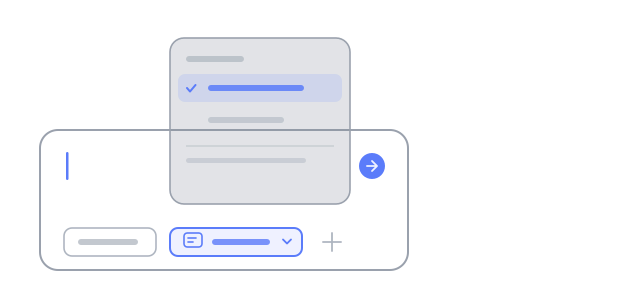

# 系统提示词预设

[English](README.md) | 中文

在输入框底部「完全权限」右侧添加一个系统提示词预设按钮，并在设置中新增「系统提示词预设」页面。选择预设只影响当前会话；从下一次模型请求开始，自定义预设的文本会替换 DSH 组装好的提示词（可选择在前面附加一段简短的 DSH 基础信息），而不是追加在后面。



## 安装

要求：**DeepSeek Harness 0.2.2-rc.5** 或更新版本，需提供 `systemPrompt`、`sessionProjections`、`settings`、`commands` 这些 Host 服务，以及 `conversation.input.left` / `settings.section` 客户端插槽。开发与测试环境为 Desktop（`desktop`）profile。

1. 克隆到固定目录并安装 Host 依赖：

   ```sh
   git clone https://github.com/WMZZwmzz/dsh-prompt-presets.git
   cd dsh-prompt-presets
   pnpm install --prod
   ```

2. 把这个目录作为 bundle 加入 DSH profile。插件管理器的 **Install bundle** 支持本地目录；手动链接时，profile 的 `package.json` 需要：

   - 依赖项：`"@local/prompt-presets": "link:<本目录绝对路径>"`；
   - 在同一个文件的 `dsh.profile.bundles` 中加入 `"@local/prompt-presets"`。

3. 重启 DSH 一次。Host 半边（`Config` schema 和 `system-prompt/assemble` 监听器）在启动时加载；只刷新页面只会更新浏览器半边。

4. 打开 **设置 → 系统提示词预设**，添加预设并保存，然后在输入框底部的预设按钮中切换当前会话。

> 本插件针对 DSH 0.2.2-rc.5 的 API 编写；如果未来的 DSH 版本改动提示词组装或设置 API，可能需要相应更新。

## 行为

- **位置** — 一个 `conversation.input.left` 插槽条目；按钮带 `order: 2`，所以在已安装的 `claude-style` 皮肤下位于权限组（`order: 1`）和命令加号按钮（`order: 3`）之间。没有该皮肤时这一行没有显式 order，按钮停在权限/计划控件右侧。
- **状态** — 一个 Host 会话投影 `promptPreset`，由插件自己的 `/prompt-preset <id>` 命令记录（`command/run` + `command/done`）折叠而来。选择保存在会话日志里，重新打开或恢复会话会恢复它；其他会话各自保留自己的选择。
- **预设来源** — `prompt-presets` Host 行的实时设置表单。按钮和设置页读取同一份值，所以保存的修改会立即到达输入框。
- **系统提示词** — 一个前置（prepend）的 `system-prompt/assemble` 监听器。当会话选中的是自定义预设时，它用预设文本替换 DSH 的人格/身份 section（`plugin:prompt-preset`，`interpolate: false`）。`keepDshMechanics` 开启时（默认），DSH 的非人格 section——计划模式、PTC SDK、工具规范、Web 安全、文件引用、MCP 说明——会保留在预设文本之后，所以模式和工具行为照常工作；关闭后才是完全整段替换。`keepDshBasics` 开启时（默认），会先附加一段简短的 `DSH_BASICS_TEXT` 前言——身份、工具使用说明和环境提示。内置 `default` 预设不修改组装结果，即使用 DSH 自己的提示词。子代理会话（session header `origin: 'subagent'`）也会跳过。
- **子代理** — 子代理会话不记录选择，会被跳过，所以保留 DSH 自己的系统提示词。
- **缓存** — 切换会重写系统提示词，缓存的请求前缀可能失效。
- **回执** — 每次切换都会执行一条真实的会话命令，所以对话里会出现一条命令回执（`prompt-preset`，摘要为预设名称），与 DSH 自带的 `/permission` 切换行为一致。

## 设置页

**设置 → 系统提示词预设** 用于编辑预设列表：

- **DSH 原有提示词 / DSH original prompt**（内置、锁定）：不修改 DSH 组装好的系统提示词。不可删除、不可填写文本；页面会清除配置里给它写的文本，并保留已存储的名称。
- **保留 DSH 运行机制**（可选项，默认开启）：在自定义预设之后保留 DSH 的非人格 section——计划模式、PTC SDK、工具规范、Web 安全、文件引用、MCP 说明。关闭后预设文本就是完整的系统提示词。
- **自定义预设的基础信息**（可选项）：在每个自定义预设前保留一段简短的 DSH 前言。页面会展示原文（身份、工具说明、环境提示）；它只是摘要，不能替代上面的运行机制选项。
- **自定义预设**：名称 + **系统提示词**（选中后替换 DSH 的人格/身份；除非关闭运行机制，否则运行 section 保留）、添加/删除，以及 **设为默认** 单选。名称必须唯一，提示词文本不能为空；空文本会清空自定义提示词。
- **保存** 通过 profile 设置文档原子写入 `presets`、`defaultPreset`、`keepDshBasics` 和 `keepDshMechanics`，重启后仍然有效。**还原** 恢复到上次保存的值。与其他页面冲突时会保留草稿并提示再次保存。
- **草稿** 在浏览器插件保持加载期间，切换设置分区或关闭设置面板都不会丢失；刷新页面会丢弃草稿。

标记为默认的预设用于新建会话。当前会话请在输入框底部的预设按钮中切换；在这里保存不会改写已有会话的选择。预设从列表中删除后，正在使用它的会话会回退到默认预设，按钮菜单会给出提示。

## 配置

`cordis.patch.yml` 中随插件提供的行是基础层；设置页会写入 profile 覆盖层：

```yaml
- insert:
    - id: prompt-presets
      name: '@local/prompt-presets'
      config:
        defaultPreset: default
        keepDshBasics: true
        keepDshMechanics: true
        presets:
          - id: default
            label: DSH 原有提示词
            text: ''
          # 自定义预设替换 DSH 的人格/身份，文本不能为空；除非
          # keepDshMechanics 为 false，否则 DSH 的运行 section 会保留。
          # - id: concise
          #   label: 简洁
          #   text: |
          #     你是一个简洁的编程助手……
```

规则：`id` 匹配 `^[a-z][a-z0-9_-]*$` 且唯一（它是命令参数）；`label` 非空；`text` 为字符串，自定义预设的文本不能为空；`defaultPreset` 必须是已配置的 id；`keepDshBasics`、`keepDshMechanics` 为布尔值。`presets`、`defaultPreset`、`keepDshBasics` 和 `keepDshMechanics` 是 `Config` 的 volatile 字段，由设置表单实时编辑。

## 限制

- 仅作用于当前会话；子代理保留 DSH 原有系统提示词，不继承父会话的选择。
- 自定义预设替换 DSH 的人格/身份。`keepDshMechanics` 开启（默认）时，DSH 的运行 section 会保留在提示词里，但预设仍可以指示模型忽略它们；保留不等于强制执行。关闭后预设就是完整提示词，除非预设自行提供，DSH 的身份、工具说明和环境信息不会被包含；可选的「基础信息」只提供简短摘要。
- 内置 default 按设计就是直通；需要不同提示词请新建自定义预设。
- 预设文本按字面插入——`{{...}}` 组不会被插值。
- 如果会话所用智能体预设带完整 persona（例如自带 `minimal` 预设配合 `@deepseek-ai/dsh-persona` 的 `complete: true`），整个系统提示词会被该 persona 取代，本插件的预设不会生效；`keepDshMechanics` 也无法覆盖 complete section。
- 如果自定义智能体预设或其他插件也在同一个 waterfall 里替换 sections，本插件会在它之后组合而不是覆盖：机制开启时会保留它的非人格 section。如果那套组合期望独占整个提示词，请在该会话关闭机制保留。
- 禁用插件会移除按钮和提示词替换；已记录的选择仍保留在会话日志中。
- 不会重放父会话命令事件的 fork 会话会回退到 `defaultPreset`。
- 安装或升级 Host 半边需要重启 DSH；只刷新页面只会更新浏览器半边。

## 开发

Host 是纯 ESM，客户端是单个浏览器 bundle——没有构建步骤。测试使用 Node 内置的 `node:assert/strict`（不依赖测试框架）：

```sh
node test/model.test.mjs   # Host 逻辑、配置、投影、提示词文本
node test/client.test.mjs  # 浏览器 bundle 接线与插槽注册
```

只有 Host 测试需要 `pnpm install`（它导入 `@deepseek-ai/schemastery`）。要在真实 profile 中试用改动：把目录作为 bundle 安装，重启 DSH，然后使用 **设置 → 系统提示词预设** 和输入框按钮。

项目结构：

- `index.js` — Host 入口：`Config`、会话投影、`/prompt-preset` 命令、`system-prompt/assemble` 监听器、设置策略。
- `lib/model.js` — 纯函数：配置规范化、投影 fold/view、提示词文本查询、命令结果。
- `client.js` — 浏览器 bundle：输入框按钮、预设菜单、设置页。
- `cordis.patch.yml` — bundle 插入的 Loader 行。
- `locale/` — 插件管理器展示元数据；`docs/` — 详情页预览与截图；`icon.svg` — 插件图标。
- `test/` — Host 与浏览器 bundle 测试。

## 许可证

[MIT](LICENSE) © 2026 WMZZwmzz

## 文件

- `index.js` — 带 `Config` schema 的 Host 入口；`lib/model.js` — 纯配置/fold/view 逻辑；`client.js` — 浏览器 bundle（按钮 + 设置页）。
- `locale/en.json`、`locale/zh.json` — 插件管理器展示元数据；`docs/` — 详情页预览；`icon.svg` — 插件图标。
- `test/model.test.mjs`、`test/client.test.mjs` — Host 逻辑/接线与浏览器 bundle 接线测试：`node test/model.test.mjs && node test/client.test.mjs`。
- `node_modules/` 保存 pnpm 安装的 `@deepseek-ai/schemastery` 依赖，不属于发布文件列表。